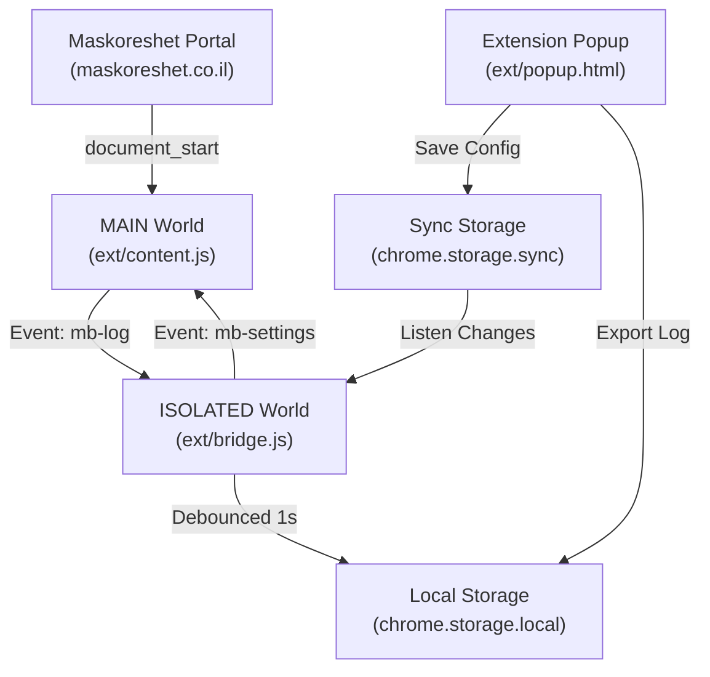

<div align="center">


<br>

### Maskoreshet Better (משכורשת+)
**Reliable UX and automation enhancement for the Maskoreshet payroll portal**<br>
A Manifest V3 extension replacing fragile Tampermonkey scripts with resilient DOM heuristics, date-lock virtualization, and focus stabilization.

<br>

<a href="#-quick-start"></a>
<a href="#-features"></a>
<a href="#-architecture"></a>
<a href="#-configuration-matrix"></a>

<br><br>


</div>

---

## 📑 Table of Contents

<table>
<tr>
<td valign="top" width="33%">

**Getting Started**
- [✨ Features](#-features)
- [🧠 Architecture](#-architecture)
- [🚀 Quick Start](#-quick-start)
- [🎮 Interactive Workflow](#-interactive-workflow)

</td>
<td valign="top" width="33%">

**Operations**
- [🧱 Project Structure](#-project-structure)
- [🔧 Configuration Matrix](#-configuration-matrix)

</td>
<td valign="top" width="33%">

**Reference**
- [💡 Design Decisions & Reliability](#-design-decisions--reliability)
- [⚠️ Known Limitations](#️-known-limitations)
- [📜 License & Credits](#-license--credits)

</td>
</tr>
</table>

---

## ✨ Features

<table>
<tr>
<td width="33%" valign="top">

### 🔒 Date Virtualization
Locks the portal accounting period via a prototype-preserving `FakeDate` implementation set to day 21, preventing the site's default monthly rollback on days 1-20.

</td>
<td width="33%" valign="top">

### 🎯 Focus Theft Guard
Captures `mousemove` events in the capture phase to neutralize the portal's `td[tabindex]` focus-stealing handler whenever any form field (`INPUT`, `TEXTAREA`, or `SELECT`) currently has focus.

</td>
<td width="33%" valign="top">

### ⚡ Enter Fast-Path
Pressing Enter in the employer directory automatically clicks the first matching employer and cascades straight into the associated workers directory.

</td>
</tr>
<tr>
<td width="33%" valign="top">

### 🔍 Smart Auto-Focus
Automatically places cursor in the employer search input (`input[id$="-SHEM"]`) or worker first-name input based on two-row header matching after 60ms.

</td>
<td width="33%" valign="top">

### 🔄 Month Retention
Detects user-initiated accounting year modifications, waits for dynamic month select options to render, and restores the targeted locked month instead of January.

</td>
<td width="33%" valign="top">

### 🧹 Banner Dismissal
Automatically locates and collapses repetitive guidance containers (`#CDV div` containing worker guidance text) across both automated and manual transitions.

</td>
</tr>
<tr>
<td width="33%" valign="top">

### ⚙️ Dedicated Popup UI
Provides toggles for every individual feature and month/year controls with warm-paper styling, dark mode support, and instantaneous reactive sync.

</td>
<td width="33%" valign="top">

### 📋 Diagnostic Telemetry
Maintains a 200-entry in-memory ring buffer with 1-second write debouncing to track UI transitions and script exceptions without storing any employer or employee PII.

</td>
<td width="33%" valign="top">

### 🛡️ Resilient Selectors
Replaces brittle dynamic identifiers (`vNNNN`) with stable structural rules, Hebrew button IDs (`#עובדים`), and semantic table row hierarchies.

</td>
</tr>
</table>

---

## 🧠 Architecture

The extension separates execution between two isolated execution contexts to operate safely under Chrome Manifest V3:



- **MAIN World (`ext/content.js`)**: Executes in the page's execution context. It wraps `window.Date` before site scripts evaluate, attaches capture listeners to shield user focus, and coordinates DOM mutation scans with debounced 150ms handlers.
- **ISOLATED World (`ext/bridge.js`)**: Mediates communication between Chrome extension APIs (`chrome.storage.sync`, `chrome.storage.local`) and the page context using `CustomEvent` channels (`mb-settings` and `mb-log`).
- **Options Popup (`ext/popup.html`, `ext/popup.js`)**: Renders settings controls, syncs values to `chrome.storage.sync`, and copies formatted diagnostic logs to the system clipboard.

---

## 🚀 Quick Start

### Installation

1. Clone or download this repository to your local workstation:
   ```bash
   git clone https://github.com/yehuda-menachem/maskor-better.git
   ```
2. Open Google Chrome and navigate to the extension manager:
   ```text
   chrome://extensions
   ```
3. Enable **Developer mode** using the toggle switch located in the upper-right corner.
4. Click the **Load unpacked** button.
5. Select the [ext](ext) folder from this project repository.
6. Navigate to `https://maskoreshet.co.il` and log into your account.

---

## 🎮 Interactive Workflow

The extension operates automatically in the background during standard payroll navigation:

1. **Employer Lookup**:
   - When entering the employer index, the cursor is placed immediately into the employer search field.
   - Type an employer search term and press `Enter`.
   - The first matching record (`td[id^="MS-SHEM-"]`) is selected, and navigation advances to the employee list.
2. **Worker Lookup**:
   - The employee table loads and automatically hides the static guidance banner.
   - The cursor moves automatically to the first-name search column resolved by text header rather than dynamic ID.
3. **Period Selection**:
   - If an accounting year dropdown changes, the extension waits for the new month list to build and restores the target month selection automatically.
4. **Log Inspection**:
   - Click the extension icon in Chrome's toolbar to toggle features or click "העתק לוג" to copy the event trace for debugging.

---

## 🧱 Project Structure

The repository contains ~6 primary operational extension files organized as follows:

```text
maskor-better/
├── ext/
│   ├── manifest.json       # Manifest V3 configuration and content script bindings
│   ├── content.js          # Core DOM automation, Date virtualization, keyboard hooks
│   ├── bridge.js           # Isolated world bridge between storage and page events
│   ├── popup.html          # Popup settings interface with Hebrew RTL styling
│   ├── popup.js            # Settings controller and diagnostic log exporter
│   └── icons/              # Extension icons in SVG and PNG formats (16px to 128px)
├── project_spec.md         # Technical specification and development changelog
└── LICENSE                 # MIT License terms
```

---

## 🔧 Configuration Matrix

All configuration flags are persisted in `chrome.storage.sync` and mirrored in `localStorage['mb-cfg']` for synchronous initialization:

| Setting | Default | Type | Description |
|---|---|---|---|
| `lock` | `true` | Boolean | Enables or disables the global `Date` override. |
| `year` | `2025` | Number | Target accounting year for date calculation (2016-2026). |
| `month` | `12` | Number | Target accounting month for date calculation (1-12). |
| `fixFocus` | `true` | Boolean | Neutralizes table mousemove handlers to prevent cursor loss during search. |
| `enterNav` | `true` | Boolean | Maps Enter key on employer table to open first employer and worker list. |
| `autoFocus` | `true` | Boolean | Automatically focuses the primary search field on view transitions. |
| `hideNotice` | `true` | Boolean | Hides the repetitive worker list explanation banner (`#CDV`). |

---

## 💡 Design Decisions & Reliability

- **Function Wrapper over ES6 Proxy**: An initial implementation wrapping `window.Date` in an ES6 `Proxy` caused measurable overhead across thousands of native date invocations on the portal. The architecture was revised to use a standard function object `FakeDate` delegating to `RealDate.prototype` with cached timestamp values (`fixedTs()`).
- **Synchronous Storage Cache**: Chrome's extension storage API is asynchronous. Because the host site determines its active accounting period immediately during initial script evaluation, settings are mirrored synchronously into `localStorage['mb-cfg']` to avoid race conditions.
- **Debounced MutationObserver**: The target portal makes rapid, frequent batch updates to the DOM. A 150ms debounce interval prevents layout thrashing during continuous DOM mutations.
- **Privacy-Preserving Telemetry**: The telemetry system is privacy-preserving by design: it never queries or captures employer names, employee identification numbers, or salary figures from the DOM. Telemetry is strictly limited to structural view names ('employers', 'workers'), navigation event triggers, configuration updates, and script error messages.

---

## ⚠️ Known Limitations

- **Concurrent Tab Logging**: The 200-item diagnostic ring buffer is maintained in-memory per-tab and flushed to `chrome.storage.local` with a 1-second debounce. If multiple tabs run the extension concurrently, their log flushes will overwrite each other (last write wins) rather than merging or interleaving.
- **Table Layout Assumptions**: The column search detection algorithm relies on a two-row table structure where the first row contains column titles and the second row contains input filters.
- **Offline Syntax Testing**: As of this writing, all modules have passed local syntax validation and automated structural checks; live verification requires an active session with the production portal.

---

## 📜 License & Credits

Released under the [MIT License](LICENSE). Maintained by [yehuda-menachem](https://github.com/yehuda-menachem) for enhanced productivity and reliability on the Maskoreshet portal.

